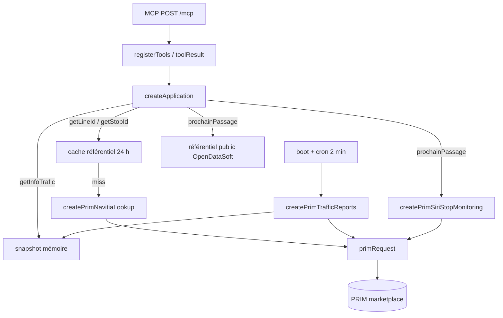

# Plan : estimation d'itinéraire

Plan d'implémentation, pas le code. Décision de forme d'abord, puis ce que l'agent d'implémentation doit construire, dans cet ordre.

**Décision.** Un seul outil MCP, `itineraire`. Il résout les deux extrémités (Zone d'arrêt, adresse ou `longitude;latitude`) puis appelle `GET /marketplace/v2/navitia/journeys`. Les horaires sont **théoriques**. Le temps réel reste `prochain_passage`. Les perturbations restent `get_info_trafic`.

Ce document sert de contrat pour l'implémentation. Tant qu'une question ouverte de Julien n'a pas de réponse, l'implémentation s'arrête au palier qui en dépend (surtout le palier 0 : accès de la clé).

## Synthèse de forme

Deux formes ont été dessinées.

| | A — un outil profond | B — deux outils (`trouver_lieu` + `itineraire`) |
| --- | --- | --- |
| Appels MCP pour « de Nation à Rivoli » | 1, ou 2 si clarification | 3 (2 géocodages + 1 calcul) |
| Politique d'ambiguïté | 2+ → `needs_clarification` sur le même outil | Liste classée ; l'agent choisit |
| Surface publique | `depart`, `arrivee`, `horaire?`, `sens?` | LieuRef + `partir_a` / `arriver_avant` + modes à éviter |
| Diff | Un port, un adapter, un use-case | Deux ports, deux adapters, grammaire `geo:`, refactor de `cachedSearch` |

**Base : A.** C'est le plus petit diff qui répond à « comment aller de X à Y » sans forcer l'agent à enchaîner deux outils. Les outils métier v1 résolvent déjà le texte eux-mêmes (spec v1, stories 3 et 6). Un second outil de géocodage casse cette habitude et déplace la règle « ne pas faire le produit cartésien » dans l'agent.

**Greffé de B.** Marquer `horaires: "théoriques"` sur chaque succès. Mapper les `error.id` Navitia (`no_solution`, `date_out_of_bounds`). Enregistrer des fixtures live avant d'écrire le parser. Chaîner les Étapes vers `prochain_passage` / `get_info_trafic` via les ids canoniques (`Cxxxxx`, id numérique de Zone d'arrêt). `disable_geojson=true`. `first_section_mode[]=walking` et `last_section_mode[]=walking`. Pas de `traveler_type`.

**Rejeté de B pour v1.** Second outil MCP, `geo:lat,lon` (Navitia parle `lon;lat`), `eviter_modes`, `accessible`, POI/commune, bbox Île-de-France, déplacement de `cachedSearch` / `normalizeStopQuery`.

## Hors périmètre de cette livraison

- Isochrones (produit PRIM distinct, quotas mensuels).
- `line_reports` v2.
- Horaires théoriques présentés comme Prochain Passage (ADR 0002).
- Grain Zone de correspondance (ADR 0003) : un Itinéraire part d'un **Lieu** Navitia, pas d'un `MonitoringRef` SIRI.
- Tarifs, polylines, listes d'arrêts intermédiaires, vélo/voiture/BSS, fauteuil, via.
- Polling. Cache des Itinéraires. Seconde variable d'environnement. Second client HTTP.

La spec v1 dit aujourd'hui : « Journey planning, isochrones, and any Navitia feature other than `traffic_reports`, `/pt_objects`, and `/places` » (`.scratch/mcp-idfm-v1/spec.md`). Ajouter l'itinéraire **rouvre ce hors-périmètre**. Ce n'est pas un patch silencieux de v1.

---

## 1. Comment les outils actuels parlent à PRIM

Quatre couches : domaine → application → infra → MCP HTTP. PRIM n'est atteint que par des adapters injectés dans `createApplication`. Les tests produit ne tapent jamais le réseau.



### Auth et client HTTP — réutilisable tel quel

- Variable `PRIM_API_KEY`. `boot()` refuse de démarrer si elle est absente ou blanche (`src/application/index.ts`). La clé n'entre pas dans `Config`.
- Composition : `src/index.ts` relit `process.env.PRIM_API_KEY` et la passe aux trois adapters PRIM (`createPrimNavitiaLookup`, `createPrimTrafficReports`, `createPrimSiriStopMonitoring`).
- Chaque requête PRIM passe par `primRequest` (`src/infra/prim-fetch.ts`) : header Fetch-légal `apiKey` (pas `API Key`, illégal dans Fetch), `AbortSignal.timeout(10_000)`, GET par défaut, pas de retry. Un non-2xx est **rendu** à l'adapter ; seul un `fetch` rejeté (timeout, réseau) est relancé.
- Pino masque `PRIM_API_KEY`, `apiKey`, `*.apiKey`, `*.PRIM_API_KEY`. Le chemin logué est `pathname + search` : ne jamais mettre la clé dans la query.
- La Zone de correspondance n'utilise **pas** `primRequest` : host public `data.iledefrance-mobilites.fr`, sans clé.

### Endpoints déjà appelés

Base Navitia : `https://prim.iledefrance-mobilites.fr/marketplace/v2/navitia` (constante privée de `prim-navitia-lookup.ts`).

| Outil | Chemin PRIM | Quand |
| --- | --- | --- |
| `get_line_id` | `/pt_objects?q=&count=1000&type[]=line` ou `/lines/line:IDFM:Cxxxxx` | miss cache 24 h |
| `get_stop_id` | `/places?q=&count=200&type[]=stop_area` ou `/places/stop_area:IDFM:{id}` | miss cache 24 h |
| `get_info_trafic` | `/traffic_reports?count=1000&disable_geojson=true&depth=1` | boot + toutes les 2 min, **pas** à l'appel |
| `prochain_passage` | SIRI `/marketplace/stop-monitoring?MonitoringRef=` | live, non caché |

`/journeys` n'existe nulle part dans le dépôt.

`get_stop_id` filtre `embedded_type === "stop_area"`. Une adresse ou un POI ne sort jamais de `searchStops`. **Ne pas élargir `searchStops`** : ça casserait le contrat Zone d'arrêt.

### Erreurs et format de sortie — réutilisable avec un choix

Deux canaux déjà compris par `toolResult` (`src/http.ts`) :

1. Throw `LookupUnavailableError` / `SnapshotUnavailableError` → MCP `isError`, phrase française, HTTP 200. Messages figés (« Recherche indisponible », « Info Trafic indisponible »).
2. Retour `{ status: "error", message }` → même wrapping MCP. C'est le canal SIRI.

`not_found` et `needs_clarification` sont des **succès** MCP (JSON intact, `source: "Île-de-France Mobilités"`).

Pour l'itinéraire : échec de recherche de lieu → `LookupUnavailableError`. Échec du calcul live → `{ status: "error", message: "Impossible de calculer l'Itinéraire" }` (canal SIRI, **sans** toucher à `instanceof` dans `http.ts`).

### Politique de match — à ne pas copier telle quelle

`decideMatches` : 0 → `not_found` ; 1 → `fiche` ; 2–5 → **union** de `fiches` ; >5 → `needs_clarification` avec **tous** les candidats.

L'union 2–5 est juste pour Info Trafic et Prochain Passage. Pour un Itinéraire, 5 départs × 5 arrivées = jusqu'à 25 `GET /journeys` et une réponse illisible. **Sur cet outil seulement** : 2 ou plus → `needs_clarification`, zéro appel `/journeys`. `decideMatches` n'est pas modifié ; le use-case traite `"few"` comme `"many"`.

### Ce qui se réutilise / ce qui ne se réutilise pas

| Pièce | Verdict |
| --- | --- |
| `primRequest`, factory `{ apiKey, fetch?, log? }`, boot `PRIM_API_KEY`, redaction | Réutiliser |
| Base URL Navitia + `/journeys` | Réutiliser la base (la recopier dans le nouvel adapter, ne pas exporter depuis le lookup) |
| `toolResult`, enveloppe `status` / `source` / `formatIsoParis` | Réutiliser |
| `canonicalLineId` sur les Étapes transport | Réutiliser |
| `searchStops` / `get_stop_id` | Trop étroit (stop_area seulement) |
| `CorrespondanceLookup` | Pas d'`navitia_id` ; grain SIRI |
| Union 2–5 de `decideMatches` | Interdite sur ce use-case |
| `LookupUnavailableError` message | OK pour le géocodage ; pas pour le calcul |
| Timeout 10 s | Réutiliser ; risque sur `/journeys` (question ouverte) |

---

## 2. Endpoints Navitia exacts via PRIM

Produit catalogue : [Calculateur Île-de-France Mobilités – Accès générique (v2)](https://prim.iledefrance-mobilites.fr/fr/apis/idfm-navitia-general-v2) (`idfm-navitia-general-v2`). Thèmes PRIM : « Calculateur d'itinéraires, Horaires théoriques ». Ce produit **inclut** recherche de lieux, horaires théoriques **et calcul d'itinéraires**.

Isochrones et `line_reports` sont d'**autres** items catalogue. Le playground PRIM le dit : champ Navitia vide = accès générique ; `isochrones` et `line_reports` = autres APIs.

URL playground ([doc PRIM](https://prim.iledefrance-mobilites.fr/fr/aide-et-contact/documentation/prise-en-main-des-api/prise-en-main-des-api-calculateur-ile-de-france-mobilites/utilisation-du-playground)) :

```text
https://prim.iledefrance-mobilites.fr/marketplace/v2/navitia/${API_NAVITIA}/${PATH}/${FEATURE}?${QUERY_PARAMS}
```

Pour l'accès générique, `API_NAVITIA` est vide. Donc :

```text
GET https://prim.iledefrance-mobilites.fr/marketplace/v2/navitia/journeys?...
GET https://prim.iledefrance-mobilites.fr/marketplace/v2/navitia/places?...
```

Auth : **le même** header `apiKey` que `/places` et `/traffic_reports`.

### `/places` — géocoder

Déjà utilisé, mais `type[]=stop_area` seulement. Pour l'itinéraire, **nouvel** appel (nouvel adapter), une page, pas de boucle 20 pages :

```text
GET .../places?q={query}&count={maxCandidates}&type[]=stop_area&type[]=address
```

Id canonique numérique :

```text
GET .../places/stop_area:IDFM:{id}
```

404 → liste vide (comme le lookup actuel). Autre non-OK → throw → `LookupUnavailableError`.

`from` / `to` de `/journeys` acceptent aussi `longitude;latitude` (ordre Navitia, ex. `2.3749036;48.8467927`, [doc Navitia `/journeys`](https://doc.navitia.io/#journeys)). Dans ce cas **aucun** `/places`.

### `/journeys` — calculer

Paramètres **utiles pour v1** (le reste reste dans l'adapter, pas sur le MCP) :

| Paramètre | Valeur v1 | Rôle |
| --- | --- | --- |
| `from` | `stop_area:IDFM:{id}` ou `lon;lat` | Départ. Obligatoire avec `to` (sinon isochrone, hors périmètre). |
| `to` | idem | Arrivée. |
| `datetime` | `YYYYMMDDTHHMMSS` mur Europe/Paris | Instant demandé. Défaut Navitia : maintenant. |
| `datetime_represents` | `departure` \| `arrival` | Après / avant cet instant. Défaut : `departure`. |
| `count` | `3` | Nombre fixe d'itinéraires distincts. |
| `data_freshness` | `base_schedule` | Théorique. Les disruptions dans la réponse sont **informatives**. `realtime` n'est pas v1 (ADR 0002 : Navitia general v2 = théorique). |
| `first_section_mode[]` / `last_section_mode[]` | `walking` | Ne pas s'appuyer sur `traveler_type` (il peut injecter voiture/vélo). |
| `disable_geojson` | `true` | Même geste que `traffic_reports` : payload plus petit. |
| `depth` | `1` | À vérifier sur fixture live (question ouverte : `stop_area` des sections). |

**Non exposés en v1 :** `forbidden_uris[]`, `allowed_id[]`, `traveler_type`, `wheelchair`, `max_nb_transfers`, `direct_path`, `timeframe_duration`, isochrone (un seul de `from`/`to`).

### Réponse à résumer — ne pas renvoyer le JSON Navitia

Objet racine ([doc Navitia](https://doc.navitia.io/#journeys)) : `journeys[]`, `disruptions[]`, `tickets[]`, `links`, `feed_publishers`.

Chaque journey :

- `duration` (secondes), `nb_transfers`, `departure_date_time`, `arrival_date_time`, `status` (effet disruption sur montée/descente : `NO_SERVICE`, `SIGNIFICANT_DELAYS`, `MODIFIED_SERVICE`, ou vide), `type` (qualification), `sections[]`.

Chaque section, `type` :

| Type Navitia | Étape MCP |
| --- | --- |
| `public_transport`, `on_demand_transport` | `ligne` (`Cxxxxx`, label, mode, headsign, de/vers, horaires) |
| `street_network` (walking), `transfer`, `crow_fly` durée > 0 | `marche` (fusionner les marches consécutives) |
| `crow_fly` durée 0 | jeter (téléport dans une stop_area) |
| `waiting` | `attente` |
| `stay_in`, `boarding`, `alighting`, `park`, `bss_*`, `ridesharing` | jeter en v1 |

Datetimes Navitia : `YYYYMMDDTHHMMSS` = heure murale du coverage. Convertir via Europe/Paris vers ISO 8601 (`formatIsoParis`), comme `navitiaDateToIso` dans `prim-traffic-reports.ts` (helper privé : **dupliquer** dans le nouvel adapter, ne pas l'exporter du trafic).

Disruptions : présentes pour information si `base_schedule`. En v1 on **n'attache pas** les messages aux Étapes. L'agent enchaîne `get_info_trafic` avec le `Cxxxxx` de l'Étape. On pose seulement `horaires: "théoriques"` pour que personne ne confonde avec SIRI.

Erreurs Navitia documentées en HTTP 404 + `error.id` (à pinner par fixture PRIM, le statut exact n'est pas dans ce dépôt) :

| `error.id` | Résultat application |
| --- | --- |
| `no_solution` | `ok` + `itineraires: []` + `summary: "Aucun itinéraire"` |
| `date_out_of_bounds` | `not_found` « Horaire hors calendrier » |
| `no_origin` / `no_destination` / `unknown_object` | `not_found` lieu |
| timeout, 401, 403, 429, 5xx | `{ status: "error", message: "Impossible de calculer l'Itinéraire" }` |

Un 403 est le signal « clé non abonnée à ce produit » — voir §4.

---

## 3. Outil MCP proposé

### Nom

`itineraire`. Même registre que `prochain_passage` (nom métier, pas `get_*`).

Description française, annotations `readOnlyHint` / `openWorldHint` comme les quatre outils. Une phrase ajoutée à `MCP_INSTRUCTIONS` : les questions d'itinéraire appellent `itineraire` directement ; `get_stop_id` n'est pas un prérequis ; une clarification est un succès, l'agent montre tous les candidats **des deux** côtés puis rappelle **une** fois.

### Schéma d'entrée

```ts
{
  depart: string;   // requis
  arrivee: string;  // requis
  horaire?: string; // ISO 8601 avec offset, ex. 2026-10-29T18:30:00+01:00
  sens?: "depart" | "arrivee"; // défaut "depart" → datetime_represents=departure
}
```

Pas de `modes`, pas de `count`, pas de `via`. `count` Navitia est fixé à 3 dans le use-case (`DEFAULT_MAX_ITINERAIRES`).

### Résolution des lieux

Chaque extrémité, **avant** tout réseau :

1. Chaîne contenant `;` → coordonnées. Doit matcher `lon;lat` avec lon ∈ [-180,180], lat ∈ [-90,90]. Sinon `not_found` « Coordonnées invalides … ». Jamais envoyée à `/places`.
2. Sinon `normalizeStopQuery` (déjà là) : `stop_area:IDFM:73641` et `STIF:StopArea:SP:73641:` → `73641`.
3. Vide après trim → `not_found` sans I/O.

Puis, **en parallèle** :

- Coordonnées → un `Lieu` synthétique `{ id: "lon;lat", genre: "coordonnees" }`. Pas d'appel, pas de cache.
- Sinon `cachedSearch` sur un **nouvel** LRU 24 h (même factory que les caches ligne/arrêt/zone, instance séparée) → `searchLieux`.
  - Id tout-chiffres → `GET /places/stop_area:IDFM:{id}`.
  - Texte → une page `/places` `type[]=stop_area` + `type[]=address`.

Ids renvoyés aux candidats, pour rappel sans second géocodage :

- Zone d'arrêt → id canonique numérique (`canonicalStopId`).
- Adresse → `lon;lat` de la coordonnée Navitia (pas d'URI `address:`).

### Politique d'ambiguïté (cet outil seulement)

| Matches d'un côté | Effet |
| --- | --- |
| 0 | `not_found` pour ce côté (ou les deux). Pas de candidats de l'autre côté. Pas de `/journeys`. |
| 1 | Lieu unique. |
| 2 ou plus | `needs_clarification`. Les deux clés `depart` / `arrivee` sont présentes (`lieu` ou `candidats`). **Zéro** `/journeys`. Y compris l'ancienne bande 2–5. |

Pire cas quota : 2 `/places` (cachés 24 h) + 1 `/journeys` (jamais caché), seulement si les deux côtés sont uniques.

### Schéma de sortie

```ts
type LieuGenre = "zone_d_arret" | "adresse" | "coordonnees";

type LieuPublic = {
  id: string;
  label: string;
  genre: LieuGenre;
  mode?: string; // seulement Zone d'arrêt
};

type EtapeItineraire =
  | { genre: "marche"; duree_secondes: number; de: string; vers: string }
  | { genre: "attente"; duree_secondes: number; lieu: string }
  | {
      genre: "ligne";
      ligne: { id: string; label: string; mode: string }; // id = Cxxxxx
      destination: string;
      de: string;
      vers: string;
      depart: string;  // ISO Paris
      arrivee: string;
    };

type Itineraire = {
  depart: string;
  arrivee: string;
  duree_secondes: number;
  changements: number; // nb_transfers Navitia, ne pas recompter les Étapes
  etapes: EtapeItineraire[];
};

type ItineraireResult =
  | {
      status: "ok";
      horaires: "théoriques";
      itineraires: Itineraire[];
      summary?: "Aucun itinéraire";
      source: "Île-de-France Mobilités";
    }
  | { status: "not_found"; message: string; source: "Île-de-France Mobilités" }
  | {
      status: "needs_clarification";
      depart: { lieu: LieuPublic } | { candidats: LieuPublic[] };
      arrivee: { lieu: LieuPublic } | { candidats: LieuPublic[] };
      source: "Île-de-France Mobilités";
    }
  | {
      status: "error";
      message: "Impossible de calculer l'Itinéraire";
      source: "Île-de-France Mobilités";
    };
```

Aucun nom Navitia sur cette surface : pas de `journey`, `section`, `embedded_type`, `datetime_represents`, `display_informations`, `geojson`, URI `line:` / `stop_area:` / `address:`.

### Signatures internes (sketch, bodies `not implemented`)

```ts
export type ItinerairePlanning = {
  searchLieux(query: string, limit: number): Promise<Lieu[]>;
  plan(input: {
    depart: Lieu;
    arrivee: Lieu;
    horaire: Date;
    sens: "depart" | "arrivee";
    count: number;
  }): Promise<
    | { kind: "ok"; itineraires: ItineraireCalcule[] }
    | { kind: "aucun" }
    | { kind: "hors_calendrier" }
    | { kind: "indisponible" }
  >;
};

export function createApplication(deps: {
  lookup: NavitiaLookup;
  correspondances?: CorrespondanceLookup;
  clock?: Clock;
  snapshot?: InfoTraficSnapshot;
  stopMonitoring?: StopMonitoring;
  itineraires?: ItinerairePlanning; // défaut : throw si la méthode est appelée
  maxCandidates?: number;
  maxPassagesPerGroup?: number;
  maxPassages?: number;
}): Application;

// sur l'objet retourné
itineraire(
  depart: string,
  arrivee: string,
  options?: { horaire?: string; sens?: "depart" | "arrivee" },
): Promise<ItineraireResult>;
```

Nouvel adapter `createPrimItineraire({ apiKey, fetch?, log? })` dans `src/infra/prim-itineraire.ts`. Il **ne** touche **pas** `prim-navitia-lookup.ts`. `src/index.ts` le passe avec la même `apiKey`.

### Termes de glossaire à ajouter à l'implémentation (pas dans ce diff)

- **Itinéraire** : trajet calculé d'un Lieu à un autre, horaires théoriques, suite d'Étapes. _Avoid_: journey, isochrone, Prochain Passage.
- **Lieu** : départ ou arrivée : Zone d'arrêt, adresse, ou `longitude;latitude`. _Avoid_: place, stop_point, POI comme mot pour tout.
- **Étape** : une marche, une attente, ou un trajet sur une Ligne. _Avoid_: section, leg.
- **Changement** : nombre de correspondances d'un Itinéraire. _Avoid_: Zone de correspondance.

### Usage agent

```text
itineraire { depart: "Nation", arrivee: "10 Rue de Rivoli, Paris" }
  → needs_clarification (plusieurs Nation) ; plan non appelé
itineraire { depart: "71264", arrivee: "2.3588;48.8556" }
  → ok, jusqu'à 3 Itinéraires théoriques
itineraire { depart: "2.2945;48.8584", arrivee: "Gare de Lyon",
             horaire: "2026-10-29T18:30:00+01:00", sens: "arrivee" }
  → ok ou clarification sur Gare de Lyon ; le départ coordonnée n'appelle pas /places
```

---

## 4. Point bloquant : la clé PRIM a-t-elle accès à `/journeys` ?

**Ne jamais lire ni afficher une valeur de secret.** Ici : présence, noms de variables, chemins d'API. Pas la valeur.

### Ce que le code et la doc disent

La clé unique du process est `PRIM_API_KEY`. Elle part en header `apiKey` via `primFetchInit`. Les trois adapters PRIM (lookup Navitia, `traffic_reports`, SIRI) reçoivent **la même** chaîne. Il n'y a pas de seconde clé « Navitia ».

Les appels Navitia déjà en production (`/places`, `/pt_objects`, `/lines`, `/traffic_reports`) tapent le produit **Accès générique v2**. La fiche PRIM de ce produit liste explicitement le calcul d'itinéraires. `/journeys` est une **feature du même item catalogue**, pas l'API Isochrones ni `line_reports`.

SIRI requête unitaire est un **autre** produit (`/marketplace/stop-monitoring`). Ça n'informe pas sur `/journeys`.

Quotas du produit Accès générique v2 (fiche PRIM) : 5 req/s et **1 000/jour** par défaut ; 10 req/s et 20 000/jour en quotas augmentés. La spec v1 compte déjà ~720 req/jour pour le cron `traffic_reports`. Lookup + SIRI + `/journeys` se partagent le reste **s'ils sont bien sur le même compteur** — hypothèse de la spec, pas une mesure.

### Ce que cette VM n'a pas pu prouver

- `PRIM_API_KEY` est **unset**. Pas de fichier `.env`. Aucun appel live n'a été tenté.
- Le dépôt ne contient aucune fixture `/journeys`, aucun 403, aucun test d'abonnement.
- PRIM exige un abonnement **par item catalogue**. Si le compte a bien l'accès générique v2 (ce que lookup + traffic_reports impliquent en prod), `/journeys` devrait répondre 200. Un 403 dirait le contraire.

### Comment Julien vérifie (sans coller la clé)

Dans le dashboard PRIM, item « Calculateur … Accès générique (v2) » : abonné.

Puis un GET (header seulement, ne pas logger la valeur) :

```text
GET https://prim.iledefrance-mobilites.fr/marketplace/v2/navitia/journeys?from=2.3749036;48.8467927&to=2.2922926;48.8583736&count=1&disable_geojson=true
```

| Statut | Lecture |
| --- | --- |
| 200 + `journeys` | Accès OK. Enregistrer le JSON **sanitisé** comme fixture. |
| 200 + `error.id=no_solution` | Accès OK, pas d'itinéraire pour ce couple. |
| 401 / 403 | Clé refusée ou non abonnée à cet item. Bloquant. |
| 429 | Quota. Accès probable, palier trop juste. |
| timeout > 10 s | `primRequest` actuel casserait le calcul. |

Tant que ce palier n'est pas vert, **ne pas implémenter l'adapter**. Les types et les tests application sur fake peuvent avancer.

---

## 5. Blast radius

**Le fait de sûreté.** Ajouter un port optionnel `itineraires?` dont le défaut throw seulement si `app.itineraire()` est appelé, plus un `registerTool` **additif**, ne change pas les quatre outils existants **à condition de ne pas modifier** `searchStops`, `decideMatches`, `primRequest`, les adapters SIRI/trafic/zones, ni les schémas des quatre `registerTool`.

Preuve au graphe d'appels (niveau 3 — le code a été lu ; les tests n'ont pas été relancés ici : pas de `node_modules` sur cette VM) :

- `createApplication` a déjà des ports optionnels (`correspondances?`, `stopMonitoring?`, `snapshot?`) avec stub qui throw (`src/application/index.ts`). Les tests identité construisent `createApplication({ lookup })` seulement (`src/application.identity.test.ts`). Un port de plus, optionnel, compile et les chemins existants ne le lisent pas.
- `getStopId` n'appelle que `lookup.searchStops`. `searchStops` force `type[]=stop_area` (`src/infra/prim-navitia-lookup.ts`). Un nouvel adapter `/places` multi-types **à côté** ne change pas cet URL.
- `http.smoke.test.ts` utilise `toContain` sur les noms d'outils, pas une liste exacte. Ajouter `itineraire` ne casse pas ces asserts. Modifier `MCP_INSTRUCTIONS` par **suffixe** préserve les `toContain("prochain_passage")` / `"Châtelet"` / `"needs_clarification"`.
- `toolSummary` ignore les clés inconnues. Sans ajout de `itineraires` dans le summary, les logs des quatre outils restent les mêmes ; l'ajout de clés **optionnelles** est additif.

**Risques retenus**

| Risque | Où | Probabilité / coût | Comment vérifier |
| --- | --- | --- | --- |
| Quota 1000/jour saturé (cron ~720 + lookup + SIRI + journeys) | spec v1, fiche PRIM | réelle / Info Trafic et lookup 404 pendant 24 h | Compteur PRIM après un soir d'usage ; ne pas cacher les Itinéraires, cacher les lieux |
| `/journeys` > 10 s | `PRIM_FETCH_TIMEOUT_MS` | inconnue / `status: "error"` | Appel live palier 0 ; si abort systématique, **alors** param optionnel de timeout sur `primRequest` (défaut 10 s) — pas un second client |
| 2–5 « Nation » : comportement différent de `prochain_passage` | `itineraire` vs `decideMatches` | certaine / l'agent doit clarifier | Description d'outil + tests « few → clarification, plan count = 0 » |
| Confusion théorique / temps réel | ADR 0002 | moyenne / mensonge à l'usager | Champ `horaires: "théoriques"` + phrase d'instructions |
| Cache 24 h d'un `/places` vide | `cachedSearch` actuel cache aussi `[]` | déjà vrai pour les arrêts / `not_found` collant | Ne pas inventer une politique différente ; documenter |
| `MCP_INSTRUCTIONS` plus longues → l'agent délaisse `prochain_passage` | `src/http.ts` | faible / horaires live manqués | Une phrase, pas un paragraphe ; smoke `toContain("prochain_passage")` |

**Cleared**

- Origin, `/health`, boot `PRIM_API_KEY`, cron Info Trafic, SIRI, référentiel zones : aucun de ces fichiers n'a besoin d'être édité pour A.
- `prim-navitia-lookup.ts` reste byte-identical.
- Pas de nouvelle env var.
- Couverture vitest : `src/application/**` à 80 %. Le use-case doit vivre dans `application/` avec `application.itineraire.test.ts`, sinon le seuil casse.

**Avant merge de l'implémentation (pas de ce plan)**

Le test le moins cher qui attrape la vraie régression : `application.identity.test.ts` + `application.passages.test.ts` + `application.traffic.test.ts` inchangés et verts, **plus** un cas « `itineraire` avec 2 départs → `plan` appelé 0 fois ».

---

## 6. Stratégie de tests

Seam produit : `createApplication`, fake `ItinerairePlanning`. C'est le contrat. Les tests n'assertent pas le JSON Navitia (spec v1 Testing Decisions).

Seam adapter : `createPrimItineraire` avec `fetch` injecté, fixtures JSON **commitées**. Assertent URLs (`/places` a les deux `type[]`, `/journeys` n'a que `from,to,datetime,datetime_represents,count,data_freshness,first_section_mode[],last_section_mode[],disable_geojson`) et le mapping vers `Lieu` / `CalculItineraire`.

Seam HTTP : smoke additif (`tools/list` contient `itineraire`, instructions mentionnent « théoriques »). Pas de test produit via Streamable HTTP.

### Cas application (fake, clock injecté)

1. Deux lieux uniques → un `plan`, `count: 3`, `sens: "depart"`, `horaire` = clock, ISO Paris, `horaires: "théoriques"`, `source`.
2. `horaire` avec offset + `sens: "arrivee"` transmis tels quels à `plan`.
3. `lon;lat` n'appelle pas `searchLieux`.
4. `;` mal formé, `horaire` sans offset, `sens` hors enum, côté blanc : pas d'I/O, `not_found`.
5. Deux départs → clarification, `plan` count = 0.
6. Deux × deux → les deux listes de candidats, `plan` count = 0 (pas 4).
7. Plus de `maxCandidates` → au plus `maxCandidates` candidats, `plan` = 0.
8. Zéro d'un côté, plusieurs de l'autre → `not_found` du côté vide, **pas** de candidats, `plan` = 0.
9. `searchLieux` throw → `LookupUnavailableError`, `plan` = 0.
10. `plan` `indisponible` → `{ status: "error" }`, la méthode ne throw pas.
11. `plan` `aucun` → `summary: "Aucun itinéraire"`.
12. `plan` `hors_calendrier` → `not_found` « Horaire hors calendrier ».
13. Même texte dans les 24 h → un `searchLieux`, deux `plan`. Après 24 h, recherche à nouveau. Le calcul n'est jamais servi du cache.
14. Rappel clarification (id numérique + `lon;lat`) → un `plan`.

Valeurs attendues : littéraux (Châtelet, `C01373`, durées en secondes), pas un recomput du mapper.

### Cas adapter

- `/places` texte : `type[]=stop_area` et `type[]=address`, pas d'autre type, pas de `start_page`.
- Id numérique → resource `stop_area:IDFM:`, 404 → `[]`.
- Adresse sans coordonnée → drop.
- Ligne sans `Cxxxxx` → `id: ""` (ne pas recopier l'URI).
- `no_solution` / `date_out_of_bounds` / 500 → les trois `kind`.
- Pas de `geojson` dans l'Étape retournée.

### Appel réel

Possible seulement si palier 0 vert. Un test **opt-in**, skip si `PRIM_API_KEY` absent :

```text
itineraire("2.3749036;48.8467927", "2.2922926;48.8583736")
```

Assert : `status === "ok"`, `horaires === "théoriques"`, `itineraires.length >= 1`, `duree_secondes > 0`. Pas d'assert sur un horaire précis (l'offre bouge). Ne pas logger la clé. Ne pas l'activer en CI par défaut (quota).

Cette VM n'a pas pu lancer cet appel.

TDD : un cas rouge → assez de code pour le vert → suivant. Pas tous les cas d'abord (skill tdd, anti-pattern horizontal slicing).

---

## 7. Étapes d'implémentation

Petites unités, chacune vérifiable. S'arrêter au palier 0 si Julien n'a pas confirmé l'accès.

**Paliers 1–8 produisent du code ; ce document ne les exécute pas.**

### Palier 0 — Accès clé (humain)

Julien exécute le GET §4. Critère : statut 200 (éventuellement `no_solution`), pas 401/403.

En parallèle, un agent peut écrire spec + types + tests application sur fake (paliers 1–3). Pas l'adapter live.

### Palier 1 — Spec et ADR

- `.scratch/itineraire/spec.md` (nouveau slug ; ne pas réécrire en silence le hors-périmètre v1).
- `docs/adr/0004-itineraire.md` : même produit PRIM que `/places` ; grain Lieu pas Zone de correspondance ; union 2–5 interdite ; `base_schedule` ; un outil.
- Entrées glossaire.

Critère : ADR + spec lus sans ouvrir le code.

### Palier 2 — Fixtures

Committer 3 JSON sanitisés (pas de clé) sous `src/infra/fixtures/` (ou à côté du test adapter) :

1. `/places?q=Nation` avec `stop_area` + éventuellement `address`.
2. `/journeys` 200 avec marche + métro + attente + métro.
3. 404 `no_solution` et 404 `date_out_of_bounds` (ou 200 + `error`, selon ce que PRIM renvoie vraiment).

Critère : un humain ouvre les fichiers et y voit `journeys` / `error.id`, pas `apiKey`.

### Palier 3 — Tests application rouges

`src/application.itineraire.test.ts` : cas 1, 5, 6, 9, 10 d'abord (tracer bullets). `createApplication` n'a pas encore `itineraire` → rouge.

Critère : `vitest run src/application.itineraire.test.ts` échoue sur « `itineraire` is not a function » ou équivalent.

### Palier 4 — Use-case vert

Types dans `src/domain/index.ts`. Port + `itineraire()` dans `createApplication`. Fake only. Pas d'HTTP, pas d'adapter PRIM.

Critère : les cas du palier 3 verts. `identity` / `passages` / `traffic` toujours verts.

### Palier 5 — Reste des cas application

Cas 2–4, 7–8, 11–14. Critère : fichier de test vert en entier.

### Palier 6 — Adapter

`src/infra/prim-itineraire.ts` + tests sur fixtures. `primRequest` inchangé. `prim-navitia-lookup.ts` inchangé.

Critère : tests adapter verts ; grep `searchStops` / `type[]=stop_area` dans le lookup = inchangé.

### Palier 7 — Câblage MCP

`src/index.ts` passe l'adapter. `registerTool`, phrase d'instructions, `toolSummary` additif. Smoke étendu.

Critère : smoke vert ; `tools/list` contient les cinq noms.

### Palier 8 — Live opt-in

Test skip si pas de clé. Une fois sur la machine de Julien après palier 0.

Critère : skip en CI ; vert en local avec la clé.

Ordre TDD : 3 → 4 → 5 → 6 → 7. Ne pas commencer par éditer `searchStops` ou `primRequest`.

---

## 8. Questions ouvertes pour Julien

Les réponses débloquent ou infléchissent. Les recommandations du plan sont en italique.

1. **Accès.** La clé de prod est-elle abonnée à « Accès générique v2 », et le GET `/journeys` du §4 rend-il 200 ou 403 ? *Sans 200, pas d'adapter.*
2. **Ambiguïté 2–5.** Clarifier (recommandé) ou prendre le premier résultat Navitia ? *Clarifier. L'union est un piège quota.*
3. **Fraîcheur.** Rester sur `base_schedule` + `horaires: "théoriques"` (recommandé, ADR 0002) ou tenter `data_freshness=realtime` dès v1 ?
4. **Types de lieux.** `stop_area` + `address` + `lon;lat` (recommandé) ou aussi POI / commune ? *POI/commune = v2, et B les réduisait de toute façon à une coordonnée.*
5. **Quota.** On livre sur le palier 1000/jour (reste ~280 après le cron) ou on demande d'abord les quotas augmentés (20 000) ?
6. **Timeout.** On reste à 10 s partagés (recommandé tant que le live n'abort pas) ou on autorise un timeout plus long **uniquement** pour `/journeys` ?
7. **Nom d'outil.** `itineraire` (recommandé) ou `estimer_itineraire` ?
8. **Info Trafic sur les Étapes.** En v1, l'agent rappelle `get_info_trafic` (recommandé) ou on annote chaque Ligne avec la sévérité du snapshot mémoire (zéro requête PRIM de plus) ?
9. **Spec.** Nouveau slug `.scratch/itineraire/` (recommandé) ou rouvrir `mcp-idfm-v1` en amendant le hors-périmètre ?

Ce plan n'implémente rien. Branche + PR draft = ce fichier seul.
